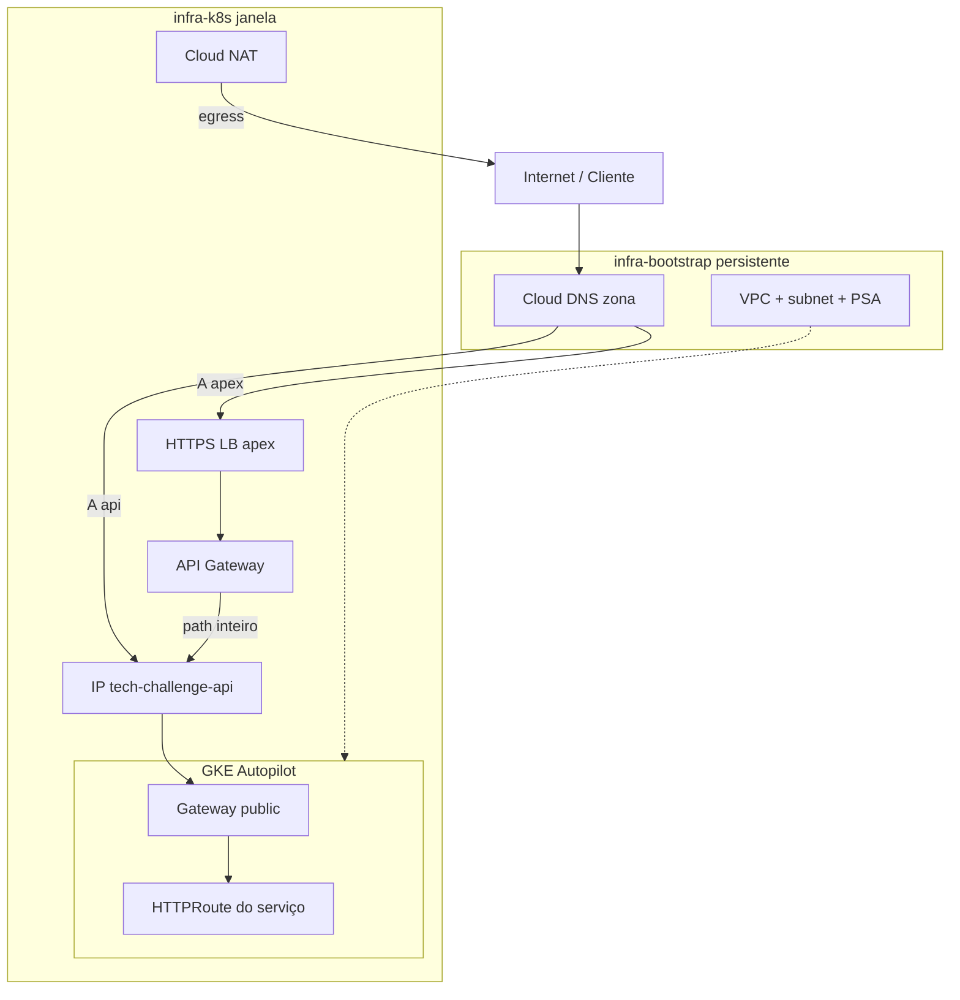

# infra-k8s

Terraform do **GKE Autopilot** que hospeda os serviços na GCP — Tech Challenge FIAP ([fiap-vcosta](https://github.com/fiap-vcosta)).

## Escopo

- Cluster GKE Autopilot regional `tech-challenge-gke` em `us-central1`, VPC-native na rede do `infra-bootstrap`, com Gateway API no canal `CHANNEL_STANDARD`
- Control plane só por **DNS endpoint** (autenticação IAM), sem endpoint IP
- **Cloud NAT** na subnet da demo (egress HTTPS dos nós privados — Datadog Agent/sink; sobe e desce com este stack)
- Bindings de Workload Identity: uma KSA por serviço, no namespace `tech-challenge`, sobre a service account de runtime do `infra-bootstrap`
- IP global `tech-challenge-api`, record `api.<domínio>` e certificado managed SSL desse hostname
- Gateway do GKE (`gke-l7-global-external-managed`) aplicado pelo workflow, mais o redirect HTTP → HTTPS
- Record apex e **API Gateway** + HTTPS LB no apex. O OpenAPI repassa o path inteiro para `https://api.<domínio>`
- State remoto em GCS (o bucket é do `infra-bootstrap` e não morre no destroy)

Este stack entrega **cluster, identidade, DNS da janela, Gateway do GKE e API Gateway**. O `HTTPRoute` e o deploy de cada serviço ficam no repositório do serviço. A rede e a **managed zone** vêm do [`infra-bootstrap`](https://github.com/fiap-vcosta/infra-bootstrap) via `terraform_remote_state`; cada serviço SQL cria a própria instância Cloud SQL. Kind / self-hosted não são caminho de entrega.

Root module: [`terraform/`](terraform/). O manifesto do Gateway é [`terraform/gke-gateway.yaml.tpl`](terraform/gke-gateway.yaml.tpl).

## Componentes (nuvem)



Entrada oficial: `https://<domínio>/{serviço}/...`. O cliente não usa `api.<domínio>`; esse nome é o backend que o API Gateway chama.

## Contrato com os serviços

O binding em [`terraform/workload-identity.tf`](terraform/workload-identity.tf) autoriza cada service account Kubernetes a assumir a service account GCP de mesmo account id. O e-mail vem de `runtime_service_account_emails` no remote state do `infra-bootstrap`.

| Account id / nome da KSA | Namespace |
|--------------------------|-----------|
| `administrativo-service` | `tech-challenge` |
| `autenticacao-service` | `tech-challenge` |
| `estoque-service` | `tech-challenge` |
| `orcamento-service` | `tech-challenge` |
| `ordem-servico-service` | `tech-challenge` |

A anotação `iam.gke.io/gcp-service-account` no manifesto do serviço usa o e-mail dessa chave. Renomear a KSA de um lado sem o outro não quebra `plan` nem `apply`: o binding aponta para uma identidade que não existe, e o sintoma aparece só em runtime.

O binding mora aqui, e não no `infra-bootstrap`, porque o pool `PROJECT.svc.id.goog` só existe enquanto há cluster com Workload Identity no projeto: ele nasce e morre com a demo.

### HTTPRoute

Cada serviço publica o próprio `HTTPRoute` no namespace `tech-challenge`, preso ao listener `https` do Gateway `public`. O listener `http` só redireciona. Exemplo:

```yaml
apiVersion: gateway.networking.k8s.io/v1
kind: HTTPRoute
metadata:
  name: administrativo
  namespace: tech-challenge
spec:
  parentRefs:
    - name: public
      sectionName: https
  rules:
    - matches:
        - path:
            type: PathPrefix
            value: /administrativo
      backendRefs:
        - name: administrativo
          port: 80
```

`/system` não entra nesse `HTTPRoute` nem no OpenAPI. O webhook `/orcamento/webhook/mercado-pago` é path público anônimo no API Gateway; a validação de `x-signature` fica no serviço.

## Entrada HTTP

O desenho é **HTTPS no apex** + **API Gateway** + **um Gateway do GKE** como único backend. Ver [ADR 004](docs/adrs/004-gke-gateway-api.md). A [ADR 002](docs/adrs/002-api-gateway.md) fica como registro do produto; a [ADR 003](docs/adrs/003-cloud-run-auth-gen1.md) foi substituída.

O produto API Gateway só expõe `*.gateway.dev` nativamente. Para `https://<domínio>/...`, este stack coloca um **HTTPS LB global** (Serverless NEG → API Gateway) na frente, com cert gerenciado no apex.

Neste stack, a cada `tf-apply`:

| Peça | Valor |
|------|--------|
| IP `tech-challenge-api` | Gateway do GKE (`api.<domínio>`) — backend |
| Certificado `tech-challenge-api-cert` | Managed SSL de `api.<domínio>`, anexado ao listener `https` |
| IP `tech-challenge-entry` | HTTPS LB da entrada (apex → API Gateway) — output `gateway_entry_ip` |
| `api.<domínio>` | A → IP do Gateway do GKE |
| Apex `<domínio>` | A → `gateway_entry_ip` |
| Gateway `public` | Classe `gke-l7-global-external-managed`, namespace `tech-challenge` |
| Entrada oficial | `https://<domínio>/{serviço}/...` |

Prefixos no OpenAPI: `/ordem-servico`, `/estoque`, `/orcamento`, `/administrativo`, `/autenticacao`, cada um no path exato e em `/{path=**}`, com GET, POST, PUT, PATCH e DELETE. `path_translation` é `APPEND_PATH_TO_ADDRESS`. Também entra `POST /orcamento/webhook/mercado-pago`. Tudo com `disable_auth: true`.

O objeto Gateway não está no state. O `tf-apply` cria cluster, IP, DNS, certificado e API Gateway, e em seguida o `kubectl apply` grava o manifesto. O `plan` de PR não precisa do cluster no ar.

A managed zone é do `infra-bootstrap`. Os records deste stack respondem na internet a cada `tf-apply`. O certificado de `api.<domínio>` fica Active depois que o DNS aponta para o IP e o Gateway anexou o certificado. Até lá o API Gateway não completa a chamada HTTPS ao backend.

**Custo:** na janela há **dois** LBs globais (entrada e Gateway do GKE). Ambos saem no `tf-destroy`. Os records da janela (incluindo o apex) sobem e descem com este stack; no destroy o apex deixa de resolver até o próximo apply.

## Acesso ao cluster

O control plane não tem endpoint IP; o acesso é pelo DNS endpoint, autenticado por IAM:

```bash
gcloud container clusters get-credentials tech-challenge-gke \
  --region us-central1 --dns-endpoint
```

## CI vs CD

| Tipo | Quando | Automático? |
|------|--------|-------------|
| **CI** `fmt` + `validate` (+ `plan` em PR) | PR / push | Sim ([`.github/workflows/ci.yml`](.github/workflows/ci.yml) → [`fiap-vcosta/actions`](https://github.com/fiap-vcosta/actions)) |
| **CI** `plan` (OIDC) | PR | Sim |
| **`tf-apply` / `tf-destroy`** | Janela da demo | Só manual (`workflow_dispatch`) |

Merge em `main` **nunca** liga o cluster. O gatilho de `tf-apply` / `tf-destroy` é **manual de propósito** (custo de Autopilot/LB); CI e `build-push` dos serviços seguem automáticos. Narrativa: [`e2e` ADR 006](https://github.com/fiap-vcosta/e2e/blob/main/docs/adrs/006-deploy-demo-manuais-custo.md).

O `tf-destroy` apaga as `HTTPRoute` do namespace, o Gateway, todo `Service type: LoadBalancer` e todo `Ingress` no job local do caller, antes do `terraform destroy` reutilizável. Em seguida espera sumir a forwarding rule do IP `tech-challenge-api`. Se ela continuar, o workflow para e o cluster não é destruído. Destruir o cluster com essa rule de pé deixa cobrança por hora mesmo sem tráfego. O `tf-apply` aplica o Gateway do GKE no job local após o apply reutilizável.

Org vars consumidas: `GCP_PROJECT_ID`, `GCP_REGION`, `GCP_WORKLOAD_IDENTITY_PROVIDER`, `GCP_SERVICE_ACCOUNT_EMAIL`, `GCP_GKE_CLUSTER_NAME`. O hostname público sai da zona DNS do `infra-bootstrap`, não de uma org var deste workflow.

## Comandos

```bash
cd terraform
terraform fmt -check
terraform init -backend=false
terraform validate
```

## Ordem na demo

1. `infra-bootstrap` aplicado (zona Cloud DNS + NS Google no domínio, uma vez)
2. Este repo → `tf-apply` (Autopilot + records `api`/apex + certificado + API Gateway + Gateway do GKE), em paralelo com `infra-events`
3. Esperar o certificado de `api.<domínio>` **Active** e o do apex **Active**
4. `tf-apply` de cada serviço (inclui 3 Cloud SQL) e `deploy`, que publicam o `HTTPRoute` no listener `https`
5. Destroy inverso: serviços (Cloud SQL + `HTTPRoute`) → este repo → `infra-events`

O `infra-bootstrap` (incluindo a zona DNS) é pré-requisito aplicado uma vez e não entra nesse ciclo. Um `tf-apply` deste repo sem serviço no ar sobe o encanamento: prefixo público chega ao Gateway e responde 404; `/system` não está no OpenAPI.

## Decisões (ADRs)

Ver [`docs/README.md`](docs/README.md): Autopilot/`tf-destroy`, API Gateway e Gateway do GKE.

## Repos da org

| Repo | Papel | Diagrama / doc-chave |
|------|--------|----------------------|
| [`infra-bootstrap`](https://github.com/fiap-vcosta/infra-bootstrap) | Rede, WIF, AR, zona DNS | Persistente |
| [`infra-events`](https://github.com/fiap-vcosta/infra-events) | Tópicos Pub/Sub | — |
| [`e2e`](https://github.com/fiap-vcosta/e2e) | Demo-up/down + ADR SQL 1:1 | [ADR](https://github.com/fiap-vcosta/e2e/blob/main/docs/adrs/001-instancia-cloud-sql-por-servico.md) |
| [`infra-k8s`](https://github.com/fiap-vcosta/infra-k8s) | GKE + Gateway do GKE + API Gateway | **Componentes (acima)** |
| [`ordem-servico-service`](https://github.com/fiap-vcosta/ordem-servico-service) | Ordens de serviço | — |
| [`estoque-service`](https://github.com/fiap-vcosta/estoque-service) | Estoque | — |
| [`orcamento-service`](https://github.com/fiap-vcosta/orcamento-service) | Orçamento | — |
| [`administrativo-service`](https://github.com/fiap-vcosta/administrativo-service) | Cadastros | — |
| [`autenticacao-service`](https://github.com/fiap-vcosta/autenticacao-service) | Login e JWT | — |
| [`building-blocks`](https://github.com/fiap-vcosta/building-blocks) | Pacote compartilhado | — |

## Agentes

Ver [AGENTS.md](AGENTS.md).
